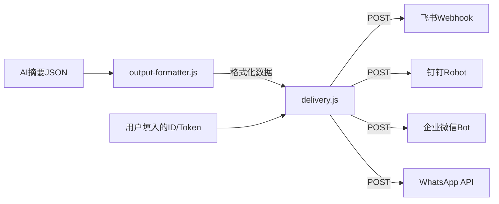

# 新建投递模块 delivery.js 及相关更新

## 架构设计

保持 formatter 和 delivery 分离，delivery.js 只管"把格式化好的数据发出去"。




在 Agent 平台上，用户只需在配置面板填入一个 Webhook URL 或 Token，delivery.js 处理剩下所有事情。

## 一、新建 `scripts/delivery.js`

### 核心设计

- **输入**: `{ formattedData, channel, config }`
  - `formattedData`: output-formatter.js 的产出
  - `channel`: feishu / dingtalk / wecom / whatsapp
  - `config`: 平台凭证（每个平台不同）
- **每个平台的 config 参数**:
  - **飞书**: `{ webhookUrl }` -- 完整 webhook 地址，或 `{ webhookId }` 自动拼接
  - **钉钉**: `{ accessToken, secret? }` -- secret 可选，用于加签安全校验
  - **企业微信**: `{ key }` -- webhook key
  - **WhatsApp**: `{ accessToken, phoneNumberId, recipientPhone }` -- Meta Business API

### 关键功能

1. **HTTP POST 封装** -- 统一的 `postJSON(url, body, headers)` 函数，使用原生 `fetch`（Node 18+）
2. **重试机制** -- 指数退避，默认 3 次重试，可配置
3. **消息分片** -- 针对有消息长度限制的平台（企业微信 text 2048 bytes / WhatsApp 4096 chars），自动拆分为多条消息顺序发送
4. **钉钉加签** -- 实现 HmacSHA256 签名（钉钉安全设置可选）
5. **错误处理** -- 返回统一的 `{ success, channel, statusCode, response, error }` 结构
6. **Dry-run 模式** -- `config.dryRun = true` 时只打印不发送，方便调试

### 各平台投递实现

- **飞书**: `POST https://open.feishu.cn/open-apis/bot/v2/hook/{id}` -- Body 直接是 formatter 产出的卡片 JSON
- **钉钉**: `POST https://oapi.dingtalk.com/robot/send?access_token={token}&timestamp={ts}&sign={sign}` -- Body 是 `{ msgtype: "markdown", markdown: {...} }`
- **企业微信**: `POST https://qyapi.weixin.qq.com/cgi-bin/webhook/send?key={key}` -- Body 是 `{ msgtype: "text", text: {...} }`，超长时自动分片
- **WhatsApp**: `POST https://graph.facebook.com/v21.0/{phoneNumberId}/messages` -- 使用 Meta WhatsApp Business API 的 text 消息格式

### 主入口

```javascript
async function main({ params }) {
  const { formattedData, channel, config } = params;
  switch (channel) {
    case 'feishu':    return sendToFeishu(formattedData, config);
    case 'dingtalk':  return sendToDingtalk(formattedData, config);
    case 'wecom':     return sendToWecom(formattedData, config);
    case 'whatsapp':  return sendToWhatsApp(formattedData, config);
  }
}
```

## 二、更新 `scripts/output-formatter.js`

### 新增 WhatsApp 格式

- 新增 `formatWhatsApp(data)` 函数
- 格式类似企业微信的纯文本，但针对 WhatsApp 特点优化：
  - 使用 WhatsApp 支持的格式标记（`*bold*`、`_italic_`、`~strikethrough~`、`code`）
  - 链接直接展示（WhatsApp 自动识别 URL 并生成预览）
  - 总长度控制在 4096 字符以内，超出时返回数组（多条消息）
- 更新 `main()` 的 switch，增加 `case 'whatsapp'`

### 新增消息分片辅助函数

- `splitMessage(text, maxLength)` -- 按段落边界智能切分长文本
- 主要供企业微信（2048 bytes）和 WhatsApp（4096 chars）使用
- 分片时在每条消息末尾加 `(1/3)` 这样的分页标记

## 三、更新 `SKILL.md`

### 新增"投递配置"章节

在"步骤 5: 发送"部分扩充，为每个平台提供：

- 获取 Webhook URL / Token 的步骤说明
- 在 Agent 平台上需要填入的参数清单
- 示例配置

### 更新文件清单

- 加入 `scripts/delivery.js`
- 更新架构图

### 更新 output-formatter.js 相关文档

- 加入 WhatsApp 格式说明

## 四、各平台消息长度限制处理策略

- **飞书**: 卡片 elements 建议不超过 50 个，当前代码已有截断（分类5篇/次级10篇），无需额外处理
- **钉钉**: Markdown 20,000 字符，一般不会超，无需处理
- **企业微信**: text 仅 2048 bytes -- 需要分片发送
- **WhatsApp**: 4096 字符 -- 需要分片发送
