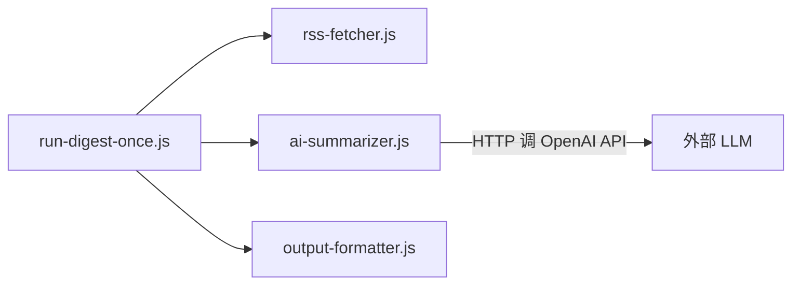
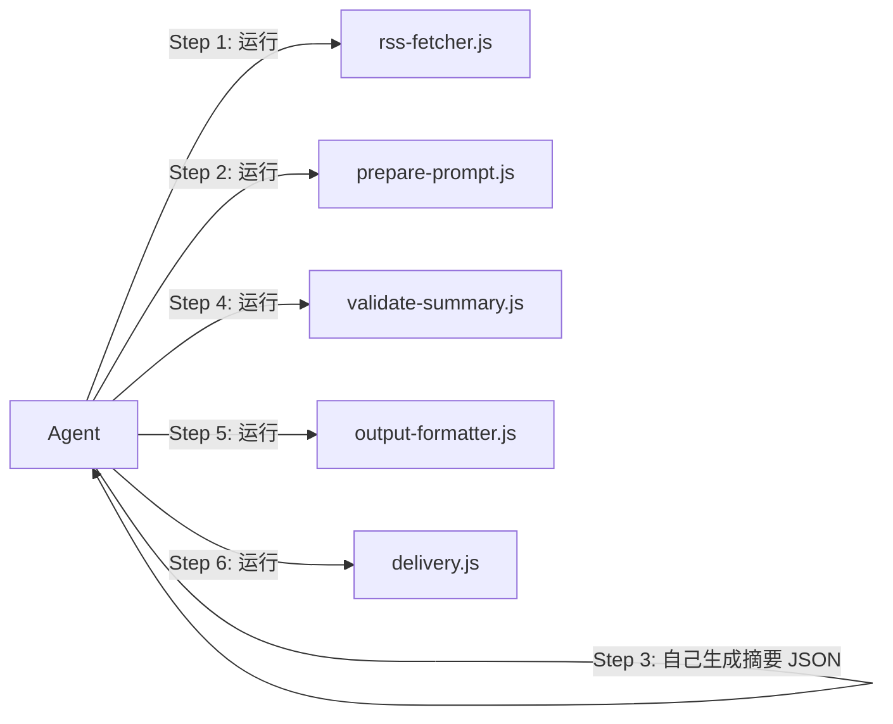

# RSS Digest — 纯 Skill 模式重构与发布

## 架构变更

当前流程（脚本自调 LLM）：




目标流程（Agent 驱动）：




核心原则：**Agent 本身就是 LLM，脚本只负责工程任务（抓取、校验、格式化、投递），不再自行调用外部 LLM。**

---

## 一、脚本层改造

### 1.1 重构 `ai-summarizer.js` → 拆为两个工具

**删除的函数：**

- `callOpenAICompatible()` — 直接 HTTP 调 LLM（第 411-455 行）
- `buildHeuristicSummary()` — 无 LLM 时的启发式兜底（第 457-498 行）
- `main()` — 串联 LLM 调用 + 校验的入口（第 500-542 行）

**保留的函数（作为 `summary-utils.js` 内部库）：**

- `buildPromptArticles()`, `buildPrompt()` — prompt 组装
- `ensureSummaryShape()` — 结构归一化
- `enforceTier1Quality()`, `enforceTier2Quality()` — 质量闸门
- `inferCategory()`, `cleanText()`, `extractJson()` 等工具函数

**新建 `scripts/prepare-prompt.js`（CLI）：**

- 读取抓取结果 JSON + prompt 模板
- 调用 `buildPromptArticles()` + `buildPrompt()` 组装完整 prompt
- 输出到 stdout 或文件
- CLI: `node scripts/prepare-prompt.js --fetchFile tmp/fetch.json --template templates/prompt-summarize-tiered.md --outFile tmp/prompt.txt`

**新建 `scripts/validate-summary.js`（CLI）：**

- 读取 Agent 生成的摘要 JSON + 抓取结果 JSON
- 调用 `extractJson()` + `ensureSummaryShape()` 做归一化和质量修复
- 输出校验后的标准 JSON
- CLI: `node scripts/validate-summary.js --input tmp/summary-raw.json --fetchFile tmp/fetch.json --outFile tmp/summary.json`

### 1.2 给 `rss-fetcher.js` 添加 CLI 入口

当前只导出 `main()` 函数，没有 argv 解析。添加尾部 CLI 块：

```javascript
if (require.main === module) {
  // 解析 --hours, --topN, --otherTopN, --outFile 等参数
  // 调用 main() 并输出 JSON
}
```

CLI: `node scripts/rss-fetcher.js --hours 24 --topN 7 --otherTopN 20 --outFile tmp/fetch.json`

### 1.3 给 `output-formatter.js` 添加 CLI 入口

同理，添加 CLI 块：

CLI: `node scripts/output-formatter.js --input tmp/summary.json --channel email --outFile tmp/formatted.json`

### 1.4 删除 `run-digest-once.js`

Agent 就是编排者，不再需要这个"一键跑完"的脚本。其中的参数解析逻辑可以复用到各个独立脚本的 CLI 入口中。

### 1.5 更新测试文件

- [summary-pipeline.test.js](scripts/summary-pipeline.test.js) — 更新 import 路径，从 `ai-summarizer` 改为 `summary-utils`
- 确保 `ensureSummaryShape` 等导出不变

---

## 二、重写 SKILL.md

当前 SKILL.md 以 `node scripts/run-digest-once.js` 命令为核心。重写后以 **Agent 分步编排**为核心：

**结构大纲（控制在 500 行以内）：**

1. **系统概览** — 一段话 + 管道图
2. **工作流程（核心）** — 6 个步骤，每步清晰的命令 + Agent 行为指导
  - Step 1: 抓取（运行 rss-fetcher.js）
  - Step 2: 组装 prompt（运行 prepare-prompt.js）
  - Step 3: 生成摘要（Agent 读 prompt，输出 JSON）
  - Step 4: 校验摘要（运行 validate-summary.js）
  - Step 5: 格式化输出（运行 output-formatter.js）
  - Step 6: 投递（运行 delivery.js，可选）
3. **模板选择** — 5 个策展模板 + 1 个摘要模板（精简表格）
4. **关键配置参数** — 每步的可调参数
5. **渠道配置速查** — 飞书/钉钉/企微/WhatsApp 配置片段
6. **常用场景** — 2-3 个典型用法（Agent 视角的指令序列）
7. **参考文档索引** — 指向 `reference/` 下的详细指南
8. **故障排查** — 精简版

**关键变化：**

- 移除所有 `OPENAI_API_KEY`、`LLM_MODEL`、`OPENAI_BASE_URL` 的引用
- 移除 `run-digest-once.js` 的所有引用
- Step 3 需要明确告诉 Agent："读取 prompt 文件，按其中的指令分析文章并生成严格的 JSON 输出"
- 移除 `allowHeuristicFallback` 相关内容（不再有降级路径）

---

## 三、项目基础设施补全

### 3.1 创建 `package.json`

```json
{
  "name": "rss-digest",
  "version": "2.3.0",
  "description": "Agent-driven RSS daily digest skill for Cursor and Claude Code",
  "engines": { "node": ">=18.0.0" },
  "scripts": {
    "test": "node scripts/summary-pipeline.test.js && node scripts/delivery.test.js",
    "fetch": "node scripts/rss-fetcher.js",
    "monitor": "node scripts/feed-quality-monitor.js"
  }
}
```

无外部 npm 依赖（全部使用 Node.js 内置模块 + 全局 `fetch`）。

### 3.2 创建根目录 `README.md`

内容：

- 项目简介（作为 Cursor / Claude Code Skill）
- 安装方式（两个平台）
- 前置要求（Node.js >= 18）
- 快速开始
- 目录结构说明
- LICENSE

### 3.3 创建 `.env.example`

只保留投递相关的可选配置（LLM 相关的全部移除）：

```
# 投递渠道配置（仅在使用 delivery.js 时需要）
# FEISHU_WEBHOOK_URL=https://open.feishu.cn/open-apis/bot/v2/hook/xxxx
# DINGTALK_ACCESS_TOKEN=xxxx
# DINGTALK_SECRET=SECxxxx
# WECOM_KEY=xxxx
```

### 3.4 更新 `.gitignore`

补充 `node_modules/`, `.env`, `.env.local`, `*.log`, `coverage/`

---

## 四、reference/ 文档更新

- [GUIDE-technical.md](reference/GUIDE-technical.md) — 移除 LLM API 调用相关内容，更新管道描述
- [GUIDE-delivery.md](reference/GUIDE-delivery.md) — 检查并保持一致
- [GUIDE-templates.md](reference/GUIDE-templates.md) — 确认模板说明与新流程一致
- [GUIDE-sources.md](reference/GUIDE-sources.md) — 应无需改动

---

## 五、发布准备

### 5.1 文件清单（最终）

```
rss-digest/
├── SKILL.md                          # 主入口（< 500 行）
├── README.md                         # 安装与使用说明
├── package.json                      # 项目元数据
├── .env.example                      # 环境变量示例
├── .gitignore                        # 完整忽略规则
├── RSS_FEEDS.md                      # 英文 RSS 源清单
├── RSS_FEEDS_CN.md                   # 中文 RSS 源清单
├── resources/
│   └── hn-popular-blogs-2025.opml
├── scripts/
│   ├── rss-fetcher.js                # 抓取（保留，加 CLI）
│   ├── summary-utils.js              # 校验工具库（从 ai-summarizer.js 重构）
│   ├── prepare-prompt.js             # 新：组装 prompt CLI
│   ├── validate-summary.js           # 新：校验摘要 CLI
│   ├── output-formatter.js           # 格式化（保留，加 CLI）
│   ├── delivery.js                   # 投递（保留）
│   ├── feed-quality-monitor.js       # 源健康监控（保留）
│   ├── summary-pipeline.test.js      # 测试（更新 import）
│   └── delivery.test.js              # 测试（保留）
├── templates/                        # 全部保留
│   ├── prompt-daily.md
│   ├── prompt-quick.md
│   ├── prompt-tech-dev.md
│   ├── prompt-product.md
│   ├── prompt-executive.md
│   ├── prompt-summarize-tiered.md
│   └── README.md
└── reference/                        # 更新 LLM 相关描述
    ├── GUIDE-sources.md
    ├── GUIDE-technical.md
    ├── GUIDE-templates.md
    └── GUIDE-delivery.md
```

### 5.2 安装说明（README.md 中）

**Cursor 安装：**

```bash
git clone <repo> ~/.cursor/skills/rss-digest
```

**Claude Code 安装：**

```bash
git clone <repo> ~/.codex/skills/rss-digest
```

**项目级安装（仅当前项目可用）：**

```bash
git clone <repo> .cursor/skills/rss-digest
```

