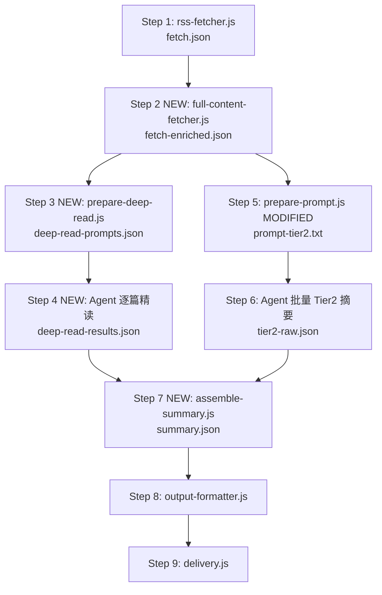

# Top 文章全文精读管线

## 架构变更概览

当前管线是"一锅炖"：所有文章截断后塞进一个 prompt，一次 LLM 调用生成全部摘要。
改造后 Top 文章走独立精读管线，Tier2 文章保持批量处理不变。




**关键设计决策**: Step 3-4 (精读) 和 Step 5-6 (Tier2 批量) 可以并行执行，互不依赖。

---

## 新增文件清单

### 1. `scripts/full-content-fetcher.js` — 回源抓全文

**职责**: 读取 `fetch.json`，对 `topArticles` 的每篇文章用 URL 回源抓取网页，通过 `@mozilla/readability` + `jsdom` 提取正文全文。

**命令**:

```bash
node scripts/full-content-fetcher.js \
  --fetchFile tmp/fetch.json \
  --outFile tmp/fetch-enriched.json
```

**输入**: `fetch.json`（现有格式不变）

**输出**: `fetch-enriched.json`（结构与 `fetch.json` 相同，但 `topArticles` 每项新增 `fullContent` 字段）

**核心逻辑**:

- 仅对 `topArticles` 抓取全文（`otherTopArticles` 不抓，节省时间）
- 并发控制（复用 `CONFIG.CONCURRENCY = 5`）
- 超时 15s，失败则保留 RSS 原始 `content` 作为 fallback
- `fullContent` 字段不做字符截断，保持全文
- 新增 `fullContentMeta`: `{ fetchedFrom: 'web' | 'rss-fallback', charCount: number }`

**依赖**: `@mozilla/readability`, `jsdom`（加到 `package.json` 的 `dependencies`）

### 2. `templates/prompt-deep-read.md` — 通用单篇精读 prompt

**设计原则**: 一个通用 prompt，通过 `{{templateName}}` + `{{templateHints}}` 让 LLM 自适应分析角度。

模板结构:

```markdown
# Role
你是一位资深编辑，正在为"{{templateName}}"视角的每日精选做单篇深度摘要。

# 分析视角
{{templateHints}}

# 文章信息
- 标题: {{title}}
- 来源: {{source}}
- 链接: {{link}}
- 发布时间: {{pubDate}}

# 全文
{{fullContent}}

# 输出要求
基于上述分析视角，对这篇文章进行深度分析。

## 通用字段（必填）
- summary: 6-10 句结构化摘要（背景 -> 核心论点 -> 关键论据 2-3 个 -> 影响与启示）
- keyPoints: 3-5 条要点，每条 1-2 句
- quotable: 原文中最有力/最精彩的一句话（直接引用原文）
- action: 1 条针对目标读者的可执行建议
- risk: 1 条潜在局限性或反面观点
- category: 编程|AI|系统|硬件|安全|创业|综合

## 视角专属字段（按 templateName 自行判断补充）
根据分析视角名称，自行补充最相关的专属分析字段到 extra 对象中。
例如 tech-dev 可补充技术雷达评估，product 可补充市场机会分析，
executive 可补充战略影响评估。不限定具体字段，由你根据视角判断。

# Output (Strict JSON)
{
  "title": "...",
  "link": "...",
  "source": "...",
  "category": "...",
  "summary": "...",
  "keyPoints": ["...", "..."],
  "quotable": "...",
  "action": "...",
  "risk": "...",
  "extra": { ... }
}
```

**模板提示词映射** (硬编码在 `summary-utils.js` 中):

- **daily**: "日常科技阅读视角，面向技术从业者，关注信息密度和实用价值"
- **quick**: "快速判断视角，只关注核心结论和阅读价值判断"
- **tech-dev**: "技术评估与学习路径视角，面向中高级开发者和架构师，关注技术成熟度、适用场景和学习建议"
- **product**: "产品洞察视角，面向产品经理和创业者，关注产品创新、市场机会和可借鉴性"
- **executive**: "战略决策视角，面向高管和投资人，关注商业影响、竞争格局和行动建议"
- **summarize-tiered**: "分层摘要视角，兼顾深度与广度，提供全面的结构化分析"

### 3. `scripts/prepare-deep-read.js` — 生成逐篇精读 prompt

**职责**: 读取 `fetch-enriched.json`，为每篇 Top 文章生成独立的精读 prompt。

**命令**:

```bash
node scripts/prepare-deep-read.js \
  --fetchFile tmp/fetch-enriched.json \
  --template daily \
  --outFile tmp/deep-read-prompts.json
```

**输出**: `tmp/deep-read-prompts.json`

```json
{
  "templateName": "daily",
  "prompts": [
    { "rank": 1, "title": "...", "link": "...", "prompt": "完整 prompt 文本" },
    { "rank": 2, "title": "...", "link": "...", "prompt": "完整 prompt 文本" },
    ...
  ]
}
```

**核心逻辑**:

- 读取 `templates/prompt-deep-read.md` 模板
- 从 `summary-utils.js` 获取 `templateName` 对应的 `templateHints`
- 对每篇 topArticle，用 `fullContent`（优先）或 `content`（fallback）填充模板
- 输出结构化的 prompts 数组，供 Agent 逐条处理

### 4. `scripts/assemble-summary.js` — 汇合精读与粗读

**职责**: 将逐篇精读结果 + Tier2 批量摘要结果合并为统一的 `summary.json`。

**命令**:

```bash
node scripts/assemble-summary.js \
  --deepReadResults tmp/deep-read-results.json \
  --tier2Raw tmp/tier2-raw.json \
  --fetchFile tmp/fetch.json \
  --outFile tmp/summary.json
```

**核心逻辑**:

- 精读结果 -> 映射为 `tier1[]` 格式
- Tier2 批量结果 -> 映射为 `tier2[]` 格式
- 合并后调用现有 `ensureSummaryShape()` 做最终归一化和质量闸门
- 精读结果的质量闸门放宽（已经是全文精读，不需要 3 句最低限制去"补全"）

---

## 修改文件清单

### 5. `scripts/summary-utils.js` — 新增精读相关工具函数

新增:

- `TEMPLATE_HINTS` 常量：模板名称到提示词的映射
- `buildDeepReadPrompt(templateText, article, templateName)`: 构建单篇精读 prompt
- `getTemplateHints(templateName)`: 获取模板提示词
- `normalizeDeepReadResult(result, rank)`: 将精读 LLM 输出归一化为 tier1 格式

修改:

- `enforceTier1Quality()`: 识别来自精读管线的 tier1 项（通过 `source: 'deep-read'` 标记），放宽截断限制
  - keyPoints 上限从 60 字符放宽到 **不限**（精读结果本身已经过 LLM 精炼）
  - action 上限从 80 字符放宽到 **不限**
  - summary 最低句数从 3 句提高到 **5 句**（精读应该更深）

### 6. `scripts/prepare-prompt.js` — 支持 Tier2-only 模式

新增 `--deepReadResults` 参数。当提供精读结果时:

- Tier1 (topArticles) 不再放入 prompt
- 只为 `otherTopArticles` 组装 Tier2 批量 prompt
- 模板变量 `{{topArticles}}` 填充为空或提示"已由精读管线处理"

### 7. `package.json` — 添加依赖

```json
{
  "dependencies": {
    "@mozilla/readability": "^0.5.0",
    "jsdom": "^25.0.0"
  }
}
```

新增 scripts:

```json
{
  "scripts": {
    "fetch-full": "node scripts/full-content-fetcher.js",
    "deep-read": "node scripts/prepare-deep-read.js",
    "assemble": "node scripts/assemble-summary.js"
  }
}
```

### 8. `SKILL.md` — 更新管线文档

更新标准执行流程，从 6 步扩展为 9 步，新增剧本 D（精读版完整流程）。

### 9. `reference/GUIDE-templates.md` — 补充精读模板说明

新增 `prompt-deep-read.md` 的说明，解释通用精读 prompt + 模板提示词映射机制。

---

## 中间产物目录约定

```
tmp/
  fetch.json                    # Step 1 输出
  fetch-enriched.json           # Step 2 输出（topArticles 含 fullContent）
  deep-read-prompts.json        # Step 3 输出（逐篇 prompt）
  deep-read-results.json        # Step 4 输出（逐篇精读结果）
  prompt-tier2.txt              # Step 5 输出（Tier2 批量 prompt）
  tier2-raw.json                # Step 6 输出（Tier2 批量摘要）
  summary.json                  # Step 7 输出（合并 + 归一化）
  formatted-<channel>.json      # Step 8 输出
```

---

## Agent 剧本示例（精读版 Email）

```bash
# Step 1: 抓取
node scripts/rss-fetcher.js --hours 24 --topN 7 --otherTopN 20 --outFile tmp/fetch.json

# Step 2: 回源抓全文
node scripts/full-content-fetcher.js --fetchFile tmp/fetch.json --outFile tmp/fetch-enriched.json

# Step 3: 生成精读 prompts
node scripts/prepare-deep-read.js --fetchFile tmp/fetch-enriched.json --template daily --outFile tmp/deep-read-prompts.json

# Step 4: Agent 逐篇精读
# Agent 读取 deep-read-prompts.json，对每条 prompt 生成摘要，写入 deep-read-results.json

# Step 5: 组装 Tier2 prompt（仅粗读部分）
node scripts/prepare-prompt.js --fetchFile tmp/fetch.json --template templates/prompt-summarize-tiered.md --deepReadResults tmp/deep-read-results.json --outFile tmp/prompt-tier2.txt

# Step 6: Agent 生成 Tier2 摘要 → tmp/tier2-raw.json

# Step 7: 汇合
node scripts/assemble-summary.js --deepReadResults tmp/deep-read-results.json --tier2Raw tmp/tier2-raw.json --fetchFile tmp/fetch.json --outFile tmp/summary.json

# Step 8: 格式化
node scripts/output-formatter.js --input tmp/summary.json --channel email --outFile tmp/formatted-email.json
```

---

## 向后兼容

- 不删除任何现有脚本或模板
- 现有 6 步流程仍然可用（不传 `--deepReadResults` 时行为不变）
- 精读管线是**可选增强**，通过是否执行 Step 2-4 来切换
- `validate-summary.js` 保持可用，`assemble-summary.js` 在内部复用其归一化逻辑

## 测试策略

- 为 `full-content-fetcher.js` 添加单元测试（mock HTTP 请求 + readability 提取）
- 为 `prepare-deep-read.js` 添加 prompt 生成测试
- 为 `assemble-summary.js` 添加合并逻辑测试
- 扩展 `summary-pipeline.test.js` 覆盖精读结果的归一化路径
